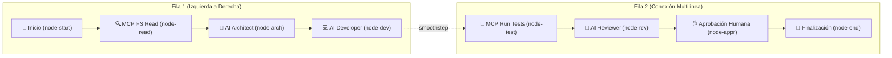
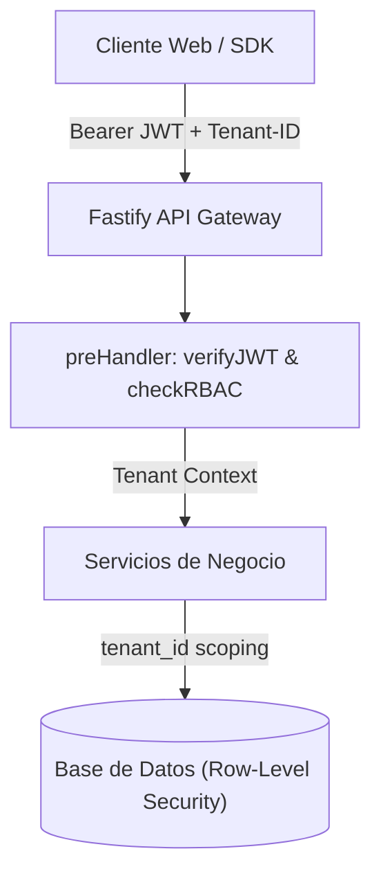

# NEXORA — Plataforma SaaS Multi-Agente & Orquestador MCP

[](https://github.com/benjamincontrerasg/nexora/actions/workflows/ci.yml)
[](LICENSE)
[](https://github.com/benjamincontrerasg/nexora/actions)
[](https://nodejs.org/)
[](https://www.typescriptlang.org/)
[](https://fastify.dev/)
[](https://react.dev/)
[](https://tailwindcss.com/)
[](README.md#-arquitectura-de-seguridad-y-zero-trust)

NEXORA es una plataforma SaaS completa diseñada para conectar múltiples proveedores de inteligencia artificial, diseñar agentes autónomos especializados, administrar servidores MCP (Model Context Protocol) bajo arquitectura Zero-Trust y crear flujos de trabajo colaborativos con un editor visual de grafos.

<p align="center">
  <strong>Claude · GPT-4o · Gemini · Ollama</strong> — Un solo panel, múltiples cerebros.
</p>

---

## 📸 Vista Previa Visual del Sistema

### 1. Editor Visual de Flujos (React Flow con Grilla Responsive y Zoom ≥ 0.75)
Pipelines multi-agente en cuadrícula inteligente de 4 columnas, aristas `smoothstep` inter-fila y paleta de nodos no intrusiva:



### 2. Dashboard de Control y Monitoreo Multi-Agente
Métricas de inferencia en tiempo real, consumo de tokens y centro de autorizaciones:

```text
┌──────────────────────────────────────────────────────────────────────────────────┐
│  NEXORA DASHBOARD                                        ● Backend: Conectado  │
├─────────────────┬─────────────────┬──────────────────┬───────────────────────────┤
│ Agentes Activos │ Servidores MCP  │ Total Ejecuciones│ Costo Inferencia (Tokens) │
│       4 / 5     │     3 Activos   │     1,280 runs   │      $14.28 USD           │
├─────────────────┴─────────────────┴──────────────────┴───────────────────────────┤
│  Métricas de Consumo de Tokens (Área Chart)       │ Aprobaciones Pendientes      │
│  [▲ OpenAI 42%]  [▲ Anthropic 38%]  [▲ Gemini 20%]│  ⚠️ write_file en src/lib/   │
│  ~~~~~~~~~~~~~~~~~~~~~~~~~~~~~~~~~~~~~~~~~~~~~~~  │  [ Rechazar ]  [ Aprobar ]   │
└──────────────────────────────────────────────────────────────────────────────────┘
```

> 📁 *Las capturas de pantalla de alta resolución se encuentran organizadas en [`docs/screenshots/`](docs/screenshots/)*.

---

## ✨ Características Principales

- 🤖 **Multi-Agente**: Orquesta agentes autónomos con roles especializados (Arquitecto, Desarrollador, Revisor, Investigador, Coordinador).
- 🔌 **Multi-Proveedor**: Conecta Claude (Anthropic), GPT (OpenAI), Gemini (Google) y modelos locales via Ollama con persistencia SQLite y TanStack Query.
- 🧩 **MCP Hub**: Registra, valida y gestiona servidores Model Context Protocol (STDIO y HTTP) bajo protocolo JSON-RPC 2.0.
- 🔄 **Workflow Visual**: Editor de grafos drag-and-drop con React Flow para diseñar pipelines multi-agente con auto-layout y zoom adaptable.
- 💬 **Chat Multi-Agente**: Conversaciones interactivas donde múltiples agentes colaboran con delegación automática.
- 🔐 **Seguridad Zero-Trust**: Cifrado AES-256-GCM en reposo para API keys, validación estricta de rutas, sandbox de binarios en el Bridge y aprobación humana para operaciones de escritura.
- 📊 **Analytics**: Dashboard con métricas de consumo de tokens, costos por proveedor y tasas de éxito.
- 🏷️ **Branding Visual**: Logos oficiales SVG de cada proveedor de IA integrados en toda la interfaz.

---

## 🏛️ Arquitectura del Repositorio

```
NEXORA/
├── backend/                       # Fastify 5 + TypeScript + SQLite + Drizzle ORM + WebSocket
│   ├── src/
│   │   ├── db/
│   │   │   ├── schema.ts          # Esquema relacional Drizzle (18 tablas)
│   │   │   ├── schema.pg.ts       # Blueprint de migración a PostgreSQL + pgvector + Multi-tenant
│   │   │   ├── connection.ts      # Conexión SQLite con WAL mode y foreign keys
│   │   │   └── seed.ts            # Seed idempotente con datos de prueba
│   │   ├── lib/
│   │   │   ├── crypto.ts          # AES-256-GCM + derivación scrypt para cifrado de API Keys
│   │   │   ├── errors.ts          # Clases normalizadas de errores HTTP
│   │   │   └── validators.ts      # Esquemas de validación Zod
│   │   ├── scripts/
│   │   │   └── rotate-key.ts      # Script de rotación de clave de cifrado sin downtime
│   │   ├── services/              # Lógica de negocio (providers, agents, mcp, workflows, chat...)
│   │   ├── routes/                # Controladores REST (/v1 y raíz)
│   │   └── index.ts               # Servidor HTTP y Gateway WebSocket
│   └── package.json
│
├── frontend/                      # React 19 + TypeScript + Vite + Tailwind CSS v4 + React Flow
│   ├── src/
│   │   ├── features/              # Módulos funcionales (Dashboard, Providers, Agents, Workflows...)
│   │   │   └── providers/hooks.ts # Hooks TanStack Query (useProviders, useConnect, useDisconnect)
│   │   ├── components/            # Primitivas UI + Layouts + Modales + ProviderLogo + AgentAvatar
│   │   ├── services/              # Cliente HTTP (apiClient) + ProvidersService dual (mock/backend)
│   │   ├── stores/                # Zustand stores (UI state sin persistencia de secretos)
│   │   ├── lib/
│   │   │   └── workflow-layout.ts # Función pura de auto-layout con detección de solapamiento
│   │   └── types/                 # Interfaces TypeScript del dominio
│   └── package.json
│
├── bridge/                        # Local Agent CLI Bridge (Ejecución segura de MCP STDIO)
│   ├── src/
│   │   ├── cli.ts                 # CLI con argumentos, soporte BRIDGE_TOKEN y banner
│   │   ├── server.ts              # API HTTP local en 127.0.0.1 con autenticación Bearer
│   │   ├── sandbox.ts             # Validación Zero-Trust de binarios y rutas autorizadas
│   │   └── process-manager.ts     # Gestión de procesos hijos STDIO y timeouts JSON-RPC (10s)
│   └── package.json
│
├── docs/                          # Documentación y capturas
│   └── screenshots/               # Capturas del editor de grafos y dashboard
├── .github/workflows/ci.yml      # CI/CD: lint, build, 39 tests, audit, CodeQL, Docker build
├── docker-compose.yml             # Despliegue containerizado multicapa
└── package.json                   # Scripts unificados de ejecución
```

---

## 🧪 Matriz Completa de Tests (39 Tests Automatizados)

El proyecto cuenta con suites de tests completas ejecutadas en Vitest para garantizar la fiabilidad del core:

| Módulo | Suite de Test | Tests | Qué valida críticamente |
| :--- | :--- | :---: | :--- |
| **`bridge/`** | `src/__tests__/sandbox.test.ts` | 3 | Whitelist estricta de binarios (`node`, `python`, `npx`, `git`) y confinamiento de rutas en sandbox. |
| **`bridge/`** | `src/__tests__/server.test.ts` | 4 | Endpoints locales en `127.0.0.1`, ping `/health` y autenticación obligatoria con `BRIDGE_TOKEN` Bearer. |
| **`backend/`** | `src/lib/__tests__/crypto.test.ts` | 4 | Cifrado AES-256-GCM, IV/salt aleatorio, detección de manipulación y rotación multi-clave. |
| **`backend/`** | `src/services/__tests__/provider.service.test.ts` | 5 | Cifrado en reposo, endpoints `/connect`, `/credentials` (DELETE), sincronización de modelo y 404s. |
| **`backend/`** | `src/services/__tests__/agent.service.test.ts` | 2 | Recuperación relacional de agentes y ciclo de vida CRUD completo. |
| **`backend/`** | `src/services/__tests__/mcp.service.test.ts` | 3 | Registro en estado `pending_validation`, activación y logs de herramientas. |
| **`backend/`** | `src/services/__tests__/chat.service.test.ts` | 3 | Mensajería multi-agente, aprobación humana y respuesta WebSocket. |
| **`frontend/`**| `src/lib/__tests__/workflow-layout.test.ts` | 5 | Algoritmo puro de grilla (máx 4 por fila, $\Delta x \ge 330$, $\Delta y \ge 240$) y detección de solapamiento. |
| **`frontend/`**| `src/services/__tests__/providers.service.test.ts` | 6 | Modo simulación reactivo, connect/disconnect y **cero fugas de API Keys** en cliente o localStorage. |
| **`frontend/`**| `src/lib/__tests__/utils.test.ts` | 4 | Funciones de formateo de moneda, duración, números y fechas. |
| **Total** | **11 Suites de Prueba** | **39** | **100% Pasados en Verde** |

Para ejecutar todas las pruebas desde la raíz:
```bash
npm test
```

---

## 🛡️ Arquitectura de Seguridad y Zero-Trust

### 1. Cifrado de Credenciales en Reposo (AES-256-GCM + scrypt)
Las claves de API de los proveedores (Anthropic, OpenAI, Gemini) se tratan como secretos de nivel bancario:
- **Derivación de Clave:** Se deriva una clave de 256 bits mediante `scrypt` a partir de `ENCRYPTION_KEY` con un `salt` criptográfico único de 16 bytes.
- **Autenticación del Cifrado:** Cada registro almacena `salt:iv:tag:ciphertext`. El tag de autenticación GCM impide ataques de manipulación o bit-flipping.
- **Separación Criptográfica de Secretos:** La firma y verificación de tokens de sesión JWT utiliza exclusivamente `JWT_SECRET` (mínimo 32 caracteres), desacoplada por completo de `ENCRYPTION_KEY`.
- **Cero Fugas en Cliente:** El frontend recibe únicamente `hasApiKey: boolean` y `status: 'connected' | 'disconnected'`. La clave nunca viaja de vuelta al navegador.

> ⚠️ **AVISO CRÍTICO SOBRE `ENCRYPTION_KEY`:**
> Cambiar o rotar `ENCRYPTION_KEY` sin ejecutar el procedimiento de migración invalida todas las API keys ya cifradas en la base de datos existente. Para rotar la clave sin pérdida de datos, utiliza siempre el script `npm run rotate-key`.
>
> Para generar claves criptográficamente seguras de 64 caracteres hexadecimales (256 bits):
> ```bash
> node -e "console.log(require('crypto').randomBytes(32).toString('hex'))"
> ```

### 2. Rotación de Clave de Cifrado sin Downtime (`rotate-key`)
El backend incluye un script para rotar la clave maestra de cifrado:
```bash
# Ejecución directa con claves antigua y nueva:
cd backend
npm run rotate-key -- "OLD_ENCRYPTION_KEY" "NEW_ENCRYPTION_KEY"
```
El script recorre todos los registros cifrados en la base de datos, los descifra con la clave anterior y los vuelve a cifrar con la nueva clave de forma atómica y segura.

### 3. Hardening del Local Agent Bridge (`bridge/`)
Para ejecutar servidores MCP que dependen de procesos locales STDIO:
- **Aislamiento de Red:** Escucha exclusivamente en `127.0.0.1` (`localhost`).
- **Autenticación Compartida:** Requiere token Bearer si `BRIDGE_TOKEN` está configurado:
  ```bash
  bridge --token "mi-token-secreto-compartido"
  ```
- **Lista Blanca Estricta de Binarios:** Solo se autorizan binarios pre-aprobados (`node`, `npx`, `python`, `python3`, `uvx`, `docker`, `git`). Comandos destructivos como `rm`, `powershell`, `sh` o ejecutables arbitrarios son bloqueados en el Sandbox.
- **Confinamiento de Rutas:** Solo se permite acceso a los directorios pasados con `--allow-dir`.
- **Timeouts JSON-RPC:** Límite estricto de 10 segundos por llamada para evitar bloqueos por procesos colgados.

---

## 🔒 Autenticación y Multi-Tenancy (Roadmap de Producción)

> **Estado actual:** La versión de desarrollo es monousuario para agilizar el setup local. Para entornos de producción expuestos a la red, se ha diseñado el blueprint de arquitectura multi-inquilino.



- **Aislamiento por Organización:** Cada tabla incluye `organization_id: uuid`. Todas las consultas Drizzle se filtran automáticamente por el inquilino autenticado.
- **Matriz de Roles (RBAC):**
  - **`Owner` / `Admin`:** Gestión de facturación, claves maestras y conexión de proveedores de IA.
  - **`Developer`:** Creación y modificación de agentes, herramientas y flujos de trabajo.
  - **`Viewer` / `Operator`:** Ejecución de flujos y visualización de analíticas sin acceso a credenciales sensibles.

---

## 📈 Escalabilidad de Base de Datos: SQLite a PostgreSQL

Para transicionar de SQLite local hacia PostgreSQL de alta concurrencia:
- **Blueprint Drizzle listo para usar:** El archivo [`backend/src/db/schema.pg.ts`](backend/src/db/schema.pg.ts) define las 18 tablas adaptadas a tipos nativos de Postgres (`uuid`, `timestamp with time zone`, `jsonb`, `vector`).
- **Memoria Semántica y RAG (pgvector):** Soporte nativo para embeddings de 1536 dimensiones (`vector(1536)`) para memoria episódica a largo plazo de agentes autónomos.
- **Pool de Conexiones:** Compatible con `pg` y PgBouncer para soportar miles de conexiones concurrentes en despliegues cloud (AWS RDS, Supabase, Neon).

---

## 🚀 Puesta en Marcha Rápida

### Prerrequisitos
- Node.js >= 20.x
- npm >= 10.x

### 1. Clonar y configurar variables de entorno
```bash
git clone https://github.com/benjamincontrerasg/nexora.git
cd nexora

# Configurar variables del backend
cp backend/.env.example backend/.env

# Generar una clave segura de 64 caracteres hex:
node -e "console.log(require('crypto').randomBytes(32).toString('hex'))"
# Coloca la clave generada en ENCRYPTION_KEY dentro de backend/.env
```

### 2. Iniciar el Backend
```bash
cd backend
npm install
npm run seed       # Inicializa la base de datos con datos base
npm run dev        # Inicia Fastify en http://localhost:3001 (WS en ws://localhost:3001/ws)
```

### 3. Iniciar el Frontend
```bash
cd frontend
npm install
npm run dev        # Inicia Vite en http://localhost:5173 (o 5174)
```

---

## 🐳 Despliegue con Docker Compose

El proyecto incluye un `docker-compose.yml` multicapa listo para producción:

```bash
# 1. Configura la clave en el archivo .env de la raíz
cp .env.example .env

# 2. Levantar los contenedores
docker compose up -d --build
```

| Contenedor | URL | Puerto | Función |
| :--- | :--- | :---: | :--- |
| **frontend** | `http://localhost:80` | 80 | Nginx sirviendo la SPA de React con proxy reverso a `/v1` |
| **backend** | `http://localhost:3001` | 3001 | API Fastify 5 + WebSocket Stream |
| **db-volume** | — | — | Volumen persistente de datos `NEXORA-db-data` |

---

## 📄 Licencia

Este proyecto está bajo la licencia [MIT](LICENSE). Libre para uso personal y comercial.
